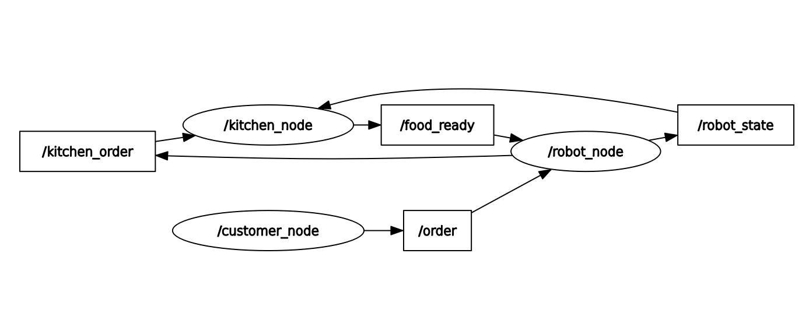

# Waiter Service Robot (ROS 2)

A small ROS 2 simulation of a restaurant with a service robot as a waiter.
Customers at 3 tables order food, the robot takes the order and passes it to the
kitchen, the kitchen cooks it (without blocking), and the robot delivers it
when it is free. The kitchen manages stock, replaces unavailable food, and
closes the restaurant when everything is sold out.

- ROS 2 Humble, Ubuntu 22.04, C++ (`rclcpp`)
- Package: `waiter_service_robot`
- Nodes: `customer_node`, `robot_node`, `kitchen_node`

## Build and run

```bash
cd ~/auriga-ros          
colcon build --packages-select waiter_service_robot
source install/setup.bash
ros2 launch waiter_service_robot robot.launch.py
```

Stop with `Ctrl+C`.

Manual checks (in a second terminal, after `source install/setup.bash`):

```bash
ros2 service call /food_available std_srvs/srv/Trigger
ros2 service call /close_restaurant std_srvs/srv/SetBool "{data: true}"
ros2 topic echo /robot_state --qos-durability transient_local --qos-reliability reliable
rqt_graph
```

## Menu

| Item   | Stock | Preparation time |
|--------|-------|------------------|
| Pizza  | 2     | 15 s             |
| Burger | 3     | 5 s              |
| Pasta  | 3     | 7 s              |

## System design

### rqt graph



### Nodes

| Node | Job |
|------|-----|
| `customer_node` | Every 5 s a random table orders a random food. First asks the kitchen if food is available. Stops ordering when the restaurant is closed. |
| `robot_node` | Helps the customer choose (2 s, state BUSY), sends the order to the kitchen, and delivers ready food (2 s, state BUSY). Keeps queues for orders and food. Publishes its state. |
| `kitchen_node` | Checks stock, substitutes unavailable food, cooks each order with its own timer, and gives ready food to the robot only when the robot is free. Closes the restaurant when all stock is 0. |

### Topics

| Topic | Type | From -> To | Meaning |
|-------|------|-----------|---------|
| `/order` | `std_msgs/String` | customer -> robot | A new order, e.g. `Table 2 requests Pasta` |
| `/kitchen_order` | `std_msgs/String` | robot -> kitchen | The robot tells the kitchen which food was ordered |
| `/food_ready` | `std_msgs/String` | kitchen -> robot | Cooked food to deliver |
| `/robot_state` | `std_msgs/String` | robot -> kitchen | `FREE` or `BUSY` (transient-local QoS) |

### Services

| Service | Type | Server | Meaning |
|---------|------|--------|---------|
| `/food_available` | `std_srvs/Trigger` | kitchen | `success = true` if the restaurant is open and at least one item is in stock |
| `/close_restaurant` | `std_srvs/SetBool` | kitchen | Send `true` to close the restaurant manually |

### Differences from the suggested setup

- `food_ready` is a **topic**, not a service. The kitchen should not block and wait for the robot to answer a request. It publishes the food and the robot queues it.
- Added a `/kitchen_order` topic, so the robot (not the customer) tells the kitchen what was ordered, as the scenario says.
- `close_restaurant` is spelled correctly. It is a manual control; the kitchen also closes automatically.

### Order flow

1. Every 5 s the customer calls `/food_available`.
2. If food is available, a random table and food are chosen. The customer takes 0.2-0.9 s to decide (always under 1 s), then publishes `/order`.
3. The robot queues the order. When free, it goes BUSY for 2 s ("choosing with the customer"), then publishes `/kitchen_order` and goes FREE.
4. The kitchen reduces the stock (or substitutes), and starts a timer for the preparation time.
5. When the food is ready, the kitchen checks the last robot state. If FREE, it publishes `/food_ready`. If BUSY, the food waits in the kitchen queue until the next FREE.
6. The robot goes BUSY for 2 s while it "delivers" (a log line) and goes FREE again.

+

### Rules implemented

- **Stock check and substitution:** if the ordered food has stock 0, the kitchen replaces it in this order: Burger, Pasta, Pizza (the first with stock). The substituted food is marked in the delivery message.
- **Closing:** when the stock of all items is 0, the kitchen closes. `/food_available` then returns `false`, and the customer stops ordering. Food already being cooked is still delivered.
- **Robot priority:** delivering food comes before taking a new order.

## Edge cases and race conditions

- **Long cooking must not block (pizza = 15 s).** No `sleep`. Each order has its own one-shot wall timer, so the kitchen keeps receiving new orders and robot messages while cooking. Finished timers are removed from the map.
- **Robot state flicker.** The robot used to publish `FREE` and then `BUSY` a moment later when work was queued, so the kitchen sent food to a robot that was about to be busy. Now the robot publishes a state only when it changes, and `FREE` only if both queues are empty.
- **Lost first state message.** The robot's first `FREE` was published before the kitchen subscribed and was lost. `/robot_state` now uses transient-local QoS (publisher and subscriber), so the kitchen gets the last state when it connects.
- **Food arrives while the robot just became busy.** The kitchen decides from the last state it saw, which can be a few milliseconds old. The robot keeps a food queue, so nothing is lost; the food is delivered after the current task.
- **Orders waiting.** If an order arrives while the robot is delivering, it waits in the robot's queue (up to about 2 s).
- **Single-threaded executors.** Each node runs on one thread, so the queues and flags need no mutex.
- **Customer after closing.** The customer cancels its timer once it sees the restaurant is closed, so it does not keep calling the service.

## Assumptions

- The "under 1 second to receive the order" rule is modeled as a customer decision time of 0.2-0.9 s before the order is published.
- Stock is reduced when the kitchen accepts the order, not when the food is ready.
- The kitchen can cook many orders at the same time (one timer per order).
- The 5 s cycle: orders are published about once every 5 s. The robot is busy 2 s per task, so it is free for part of every cycle.

## Known limitations

- An order that is already in flight when the last item is sold is rejected by the kitchen with a warning, and the customer is not told. This is rare with a 5 s cycle.
- Orders and food are plain strings (`Table 1 requests Pizza`), so the kitchen finds the food name with a text search. A custom message with table and food fields would be cleaner.
- The nodes keep running after the last delivery. Stop them with `Ctrl+C`.
- The substitution order is fixed.

## Example output

Trimmed from a real run (all three nodes are launched together):

```text
[customer_node] Published order: Table 3 requests Burger
[robot_node]    Helping customer choose food: Table 3 requests Burger
[robot_node]    Order sent to kitchen: Table 3 requests Burger
[robot_node]    Robot state: FREE
[kitchen_node]  Burger is out of stock!
[kitchen_node]  Substituting with Pasta
[kitchen_node]  Preparing Pasta (7 seconds)
[kitchen_node]  Stock: Pizza=1, Burger=0, Pasta=0
...
[kitchen_node]  Restaurant is closed to new orders.
[kitchen_node]  Sending food to robot: Food: Pizza | Order: Table 3 requests Pizza
[robot_node]    Delivering food: Food: Pizza | Order: Table 3 requests Pizza
[customer_node] Restaurant is closed. Customer stopped ordering.
[robot_node]    Food delivered successfully: Food: Pasta | Order: Table 3 requests Burger
```

## Project structure

```text
auriga-ros/                          <- workspace (repo root)
├── README.md
├── task_sources.pdf                 (from the original repo)
├── .gitignore                       (build/, install/, log/, .vscode/)
├── docs/
│   └── rqt_graph.png
└── src/
    └── waiter_service_robot/        <- the ROS 2 package
        ├── CMakeLists.txt
        ├── package.xml
        ├── launch/
        │   └── robot.launch.py      starts all three nodes
        └── src/
            ├── customer_node.cpp    random orders every 5 s
            ├── robot_node.cpp       takes orders, delivers food, publishes state
            └── kitchen_node.cpp     stock, cooking timers, closing
```